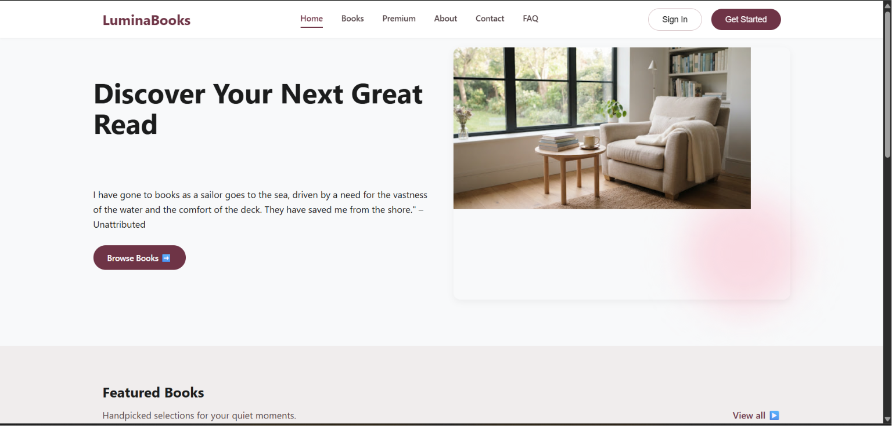
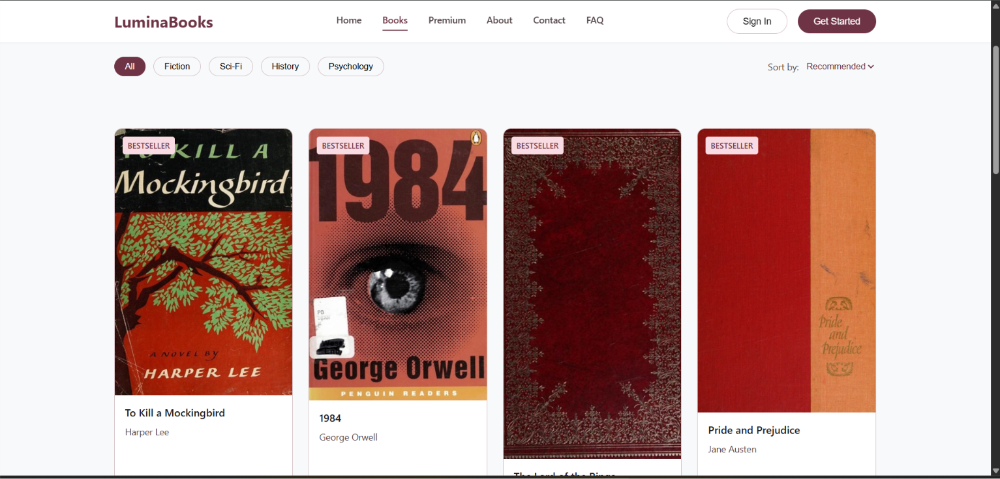
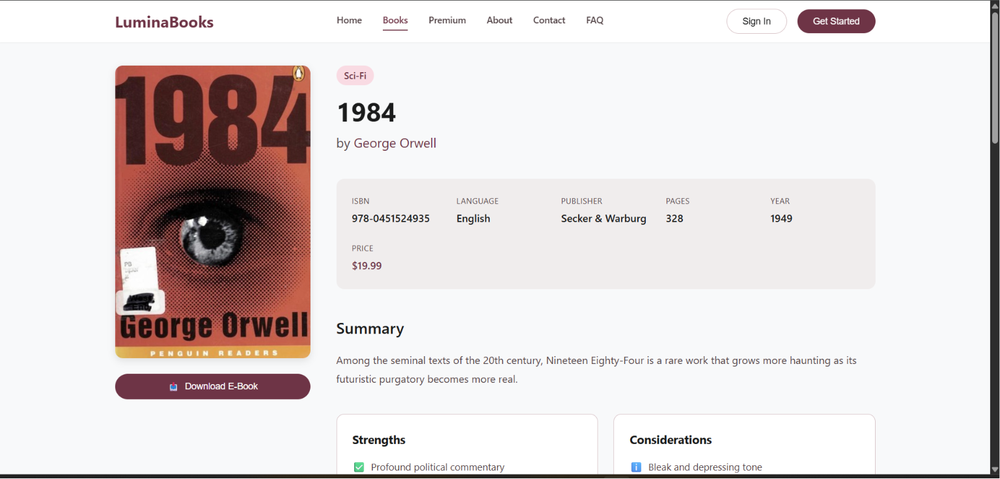
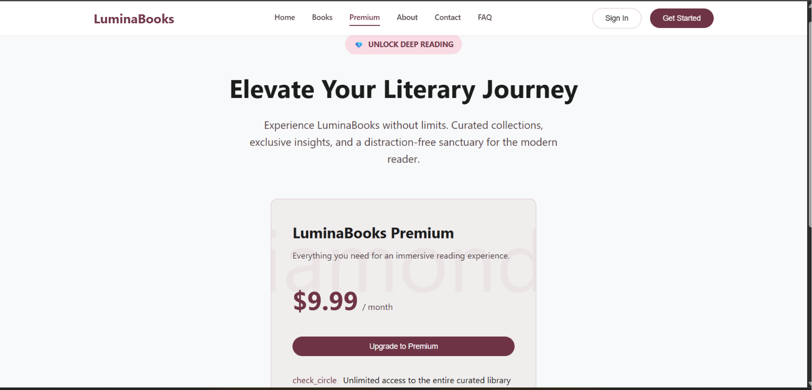
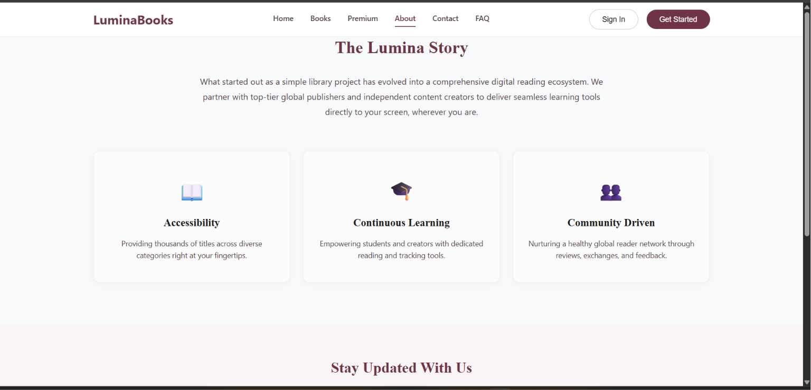
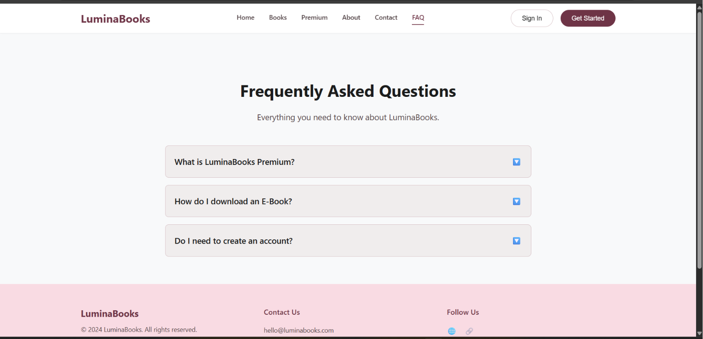

<div align="center">

# LuminaBooks
**Discover Your Next Great Read**

A comprehensive, client-side digital reading ecosystem providing high-quality literature, tech resources, and academic books directly to your screen.

[](https://opensource.org/licenses/MIT)
[](#)
[](#)
[](#)

</div>

---

## 📖 Overview

**LuminaBooks** is a dynamic, multi-page client-side digital library and bookstore platform built purely with standard web technologies (HTML5, CSS3, and Vanilla JavaScript) and static JSON data—with zero external frameworks or library dependencies.

The platform demonstrates how interactive catalog rendering, real-time filtering, URL-based routing, and mock authentication/subscription state management can be achieved natively in the browser with high performance and responsive design.

---

## ✨ Key Features

- **Dynamic Catalog Rendering:** Loads and renders books dynamically from a local `books.json` database.
- **Client-Side Filtering:** Instantly filter books by genre (Fiction, Sci-Fi, History, Psychology) with zero page reloads.
- **Dynamic Book Profiles:** Individual book views populated dynamically via URL query parameters (`?id=X`), featuring ratings, summaries, highlights, and reviews.
- **Interactive Review System:** Submit user reviews that dynamically update the page DOM.
- **Simulated Premium Membership:** Mock subscription checkout powered by `sessionStorage` that unlocks exclusive titles and downloads across the platform.
- **Responsive Layout:** Pure CSS Grid and Flexbox architecture optimized for desktop, tablet, and mobile devices.
- **Zero Dependencies:** Pure Vanilla HTML/CSS/JS without Bootstrap, Tailwind, or jQuery.

---

## 📸 Screenshots

* **Home Page**: Main landing page with featured sections.  
  

* **Catalog Grid**: Dynamic catalog with genre filtering.  
  

* **Book Details**: Dynamic book profile and review section.  
  

* **Premium Page**: Subscription tiers and feature comparison.  
  

* **About Page**: Mission, story, and platform values.  
  

* **FAQ Page**: Interactive help center with native expandable toggles.  
  

---

## 🛠️ Technology Stack

- **HTML5:** Semantic structuring and native interactive elements (`<details>`, forms).
- **CSS3:** Modular stylesheets, CSS Variables, Flexbox, and CSS Grid.
- **JavaScript (ES6+):** Vanilla DOM manipulation, URL query parsing, and async data fetching.
- **Storage:** `sessionStorage` for mock subscription state and `localStorage` for user preferences.
- **Data:** Static JSON files serving as local data models.

---

## 📁 Project Structure

```text
lumina_books_platform/
├── index.html                 # Main landing page
├── pages/                     # Application views
│   ├── about.html             # About story & mission
│   ├── book-details.html      # Dynamic book profile view
│   ├── books.html             # Catalog & filtering page
│   ├── checkout.html          # Mock checkout & payment flow
│   ├── contact.html           # Contact form and details
│   ├── faq.html               # Frequently asked questions
│   ├── login.html             # User authentication UI
│   ├── premium.html           # Premium subscription showcase
│   ├── privacy.html           # Privacy policy
│   └── terms.html             # Terms of service
├── css/                       # Modular Stylesheets
│   ├── global.css             # Global resets and CSS variables
│   ├── shared.css             # Shared UI components (navbar, footer, buttons)
│   └── [page].css             # Page-specific stylesheets
├── js/                        # Client-side Logic
│   ├── main.js                # Global state & navbar initialization
│   ├── books.js               # JSON fetching, filtering, and catalog rendering
│   ├── details.js             # URL parsing & single-book rendering
│   ├── checkout.js            # Mock payment processing
│   └── contact.js             # Contact form handling
├── data/                      # Local Data
│   └── books.json             # Core book catalog
└── assets/                    # Static Assets
    └── images/                # Book covers, screenshots, and logos
```

---

## 🚀 Getting Started

### Prerequisites
A modern web browser and a local HTTP static server (e.g., VS Code Live Server).

### Installation & Running Locally

1. **Clone the repository:**
   ```bash
   git clone https://github.com/yourusername/lumina_books_platform.git
   cd lumina_books_platform
   ```

2. **Launch with a local server:**
   Because data is fetched asynchronously from `books.json`, serve the project via a local server to avoid browser CORS restrictions on `file://`:
   
   - **VS Code Live Server:** Right-click `index.html` and select **"Open with Live Server"**.
   - **Python:** Run `python -m http.server 8000` and visit `http://localhost:8000`.
   - **Node.js (npx):** Run `npx serve .`

---

## 📄 Pages Directory

| Page | Description |
|------|-------------|
| `index.html` | Landing page with hero banner and highlights |
| `pages/books.html` | Dynamic book catalog with genre filters |
| `pages/book-details.html` | Book profile (`?id=X`) with dynamic review form |
| `pages/premium.html` | Premium membership plans and benefits |
| `pages/checkout.html` | Mock checkout flow setting session status |
| `pages/login.html` | Mock authentication interface |
| `pages/about.html` | Company story and mission |
| `pages/contact.html` | Support inquiry form |
| `pages/faq.html` | Expandable FAQ accordion |

---

## 🗄️ JSON Data Structure

The catalog data resides in `data/books.json`:

```json
{
  "id": 1,
  "title": "To Kill a Mockingbird",
  "author": "Harper Lee",
  "genre": "Fiction",
  "coverImage": "assets/images/books/book1.jpg",
  "summary": "Compassionate, dramatic, and deeply moving...",
  "advantages": ["Pulitzer Prize winner", "Tackles social issues"],
  "disadvantages": ["Can be emotionally heavy"],
  "rating": 4.9,
  "price": "14.99",
  "isPremiumRequired": false,
  "reviews": [
    { "user": "Alice", "comment": "A true classic." }
  ]
}
```

> **Adding Books:** Adding an item to `books.json` automatically updates the catalog grid and dynamic detail pages without modifying JavaScript logic.

---

## 💎 Premium Simulation Flow

1. **Subscription:** Select a plan on `premium.html` to proceed to checkout.
2. **Checkout:** Submitting the form on `checkout.html` sets `sessionStorage.setItem('premium', 'true')`.
3. **Global State:** `main.js` detects the session flag and renders the "💎 Premium Member" badge across all navigation bars.
4. **Access Control:** `details.js` checks the session flag to allow access to premium downloads.

---

## 📜 License

This project is licensed under the MIT License - see the [LICENSE](LICENSE) file for details.
